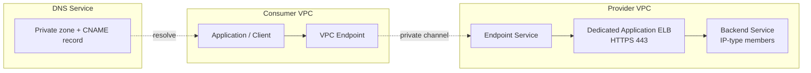
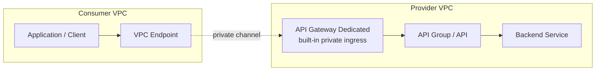

# Private SaaS Access Reference Architectures

<!-- Section 1: Title & Badges -->
[](LICENSE)
[](https://support.huaweicloud.com/intl/zh-cn/)
[](#)

> Multi-tenant private SaaS access reference architectures built on VPC endpoint services

---

## Table of Contents

- [1. Overview](#1-overview)
- [2. Architecture](#2-architecture)
- [3. Highlights](#3-highlights)
- [4. Cloud Services Involved](#4-cloud-services-involved)
- [5. Prerequisites](#5-prerequisites)
- [6. Quick Start](#6-quick-start)
- [7. Step-by-Step Deployment](#7-step-by-step-deployment)
- [8. Usage / Validation](#8-usage--validation)
- [9. Cleanup](#9-cleanup)
- [10. Detailed Explanation](#10-detailed-explanation)
- [11. Dependencies](#11-dependencies)
- [12. FAQ / Troubleshooting](#12-faq--troubleshooting)
- [13. Contributing](#13-contributing)
- [14. License](#14-license)
- [15. Contact / Maintainer](#15-contact--maintainer)

---

## 1. Overview

This repository delivers two reference architectures for exposing a SaaS service to consumers in other VPCs over private connectivity. No public ingress is required on the provider side; consumers create a VPC endpoint in their own VPC and reach the service through private addresses, with no traffic traversing the public internet. It targets **platform ops / network architects / backend engineers** and serves as a **production-ready template**.

### Core Capabilities

- **Cross-VPC private access**: consumers connect to the service through a VPC endpoint; the provider side binds no public IP.
- **Two ingress forms**: direct load balancing, or API Gateway dedicated instance access — choose one based on the business scenario.
- **TLS termination & private domain name**: HTTPS terminates TLS on the provider side; consumers access via a fixed private domain name.
- **Connection admission control**: connection approval, account whitelist, endpoint access control, and listener CIDR whitelist.
- **Full IaC delivery**: one-click Terraform provisioning; provider-side and consumer-side configurations are fully independent.

---

## 2. Architecture

> The provider exposes the service through a private ingress; the consumer creates an endpoint in its own VPC, and the two ends establish a private channel via the endpoint service.

### Mode 1: Direct Load Balancer



**Key components**:

- **VPC Endpoint**: deployed in the consumer VPC and subnet; the private ingress for consumer traffic.
- **Endpoint Service**: deployed in the provider VPC; its backend resource binds the load balancer's private IP port.
- **Dedicated Application ELB**: terminates TLS on the provider side and forwards to the backend service per the server-group policy.
- **Private DNS zone**: registers an easy-to-remember domain name for the endpoint, so consumer applications never need to embed IP addresses in their configuration.

### Mode 2: API Gateway Dedicated Instance



**Key components**:

- **API Gateway dedicated instance**: creates a built-in private ingress and endpoint service, with no separate load balancer required.
- **API group & API**: organizes externally exposed interfaces by group, with path matching and backend routing.
- **Endpoint whitelist**: controls which consumers may connect through the private ingress by account.

---

## 3. Highlights

- **Zero public exposure**: the provider side binds no EIP; the attack surface is limited to inside the VPC.
- **Minimal architecture**: the endpoint service can mount a load balancer directly, with no extra layer-4 forwarding tier.
- **Consumer self-service**: the provider only needs to share the endpoint service name; the consumer establishes the connection on its own.
- **Domain decoupling**: CNAME records registered in the private DNS zone make backend IP changes transparent to consumers.
- **Multi-layer admission**: connection approval, account whitelist, endpoint access control, and listener CIDR whitelist narrow access step by step.
- **Independent two-side delivery**: provider-side and consumer-side configurations are separated, with neither side aware of the other's internal VPC details.

---

## 4. Cloud Services Involved

| Service | Purpose | Notes |
|---|---|---|
| Virtual Private Cloud (VPC) | Carries provider-side and consumer-side networks, subnets, and security groups | Both sides can be same-account or cross-account |
| Elastic Load Balance (ELB) | Mode 1 private ingress; terminates TLS and forwards backend traffic | Dedicated application type (L7 flavor) |
| VPC Endpoint (VPCEP) | Establishes the cross-VPC private channel | Provider side is the endpoint service; consumer side is the endpoint |
| API Gateway (APIG) | Mode 2 API ingress; built-in private endpoint service | Dedicated instance |
| Domain Name Service (DNS) | Private DNS zone and CNAME records | Zone must be associated with the consumer VPC |
| Identity and Access Management (IAM) | Accounts, permissions, and cross-account whitelist | Endpoint service permissions are granted by domain ID |

> **Tip**: All services can be created in one click via the Terraform in this repository. To clean up, see [Section 9 "Cleanup"](#9-cleanup).

---

## 5. Prerequisites

| Item | Requirement | Description |
|---|---|---|
| **Account** | A Huawei Cloud account with real-name authentication completed | Personal or enterprise accounts both work |
| **Permissions** | Account has IAM **Tenant Administrator** or equivalent permissions | Used to create VPC / ELB / VPCEP / APIG resources |
| **Region** | `cn-north-4` recommended | Service availability and specs vary by region |
| **Terraform** | `>= 1.5.0` | IaC deployment tool |
| **huaweicloud Provider** | `~> 1.70` | Huawei Cloud Terraform provider (validated on 1.96.0) |
| **AK/SK** | Obtain the Access Key ID and Secret Access Key from the Huawei Cloud "My Credentials" page | Do not write credentials into any code or configuration file |
| **Backend service** | A reachable business service already deployed inside the provider VPC | Requires a private address and port |

**Prepare your access keys** (obtain the AK/SK from the Huawei Cloud "My Credentials" page; choose one of the following — neither persists to disk):

**Option 1: Independent sub-module deployment (recommended)** — the Huawei Cloud provider reads the HW_* variables below automatically; no provider block needs to be declared in code.

```bash
export HW_ACCESS_KEY="<AK>"
export HW_SECRET_KEY="<SK>"
export HW_REGION_NAME="cn-north-4"
```

**Option 2: Root-module unified orchestration** (`infra/` directory, see Section 6 "Root-module one-click orchestration") — use Terraform variables.

```bash
export TF_VAR_access_key="<AK>"
export TF_VAR_secret_key="<SK>"
export TF_VAR_region_name="cn-north-4"
```

Any `.tf` file or document in the repository uses placeholders only; **no real credentials appear**.

---

## 6. Quick Start

### Mode 1: Direct Load Balancer

```bash
# 1. Enter the repository root
cd <repository-root>

# 2. Prepare your access keys (see Section 5): export HW_ACCESS_KEY / HW_SECRET_KEY / HW_REGION_NAME
#    If using the infra/ root-module orchestration instead, export TF_VAR_access_key / TF_VAR_secret_key / TF_VAR_region_name

# 3. Provider side: create the load balancer and endpoint service
cd infra/elb_vpcep_service
cp terraform.tfvars.example terraform.tfvars
# Edit terraform.tfvars per your environment
terraform init
terraform plan
terraform apply -auto-approve
```

### Mode 2: API Gateway Dedicated Instance

```bash
cd <repository-root>/infra/apig_vpcep_service
cp terraform.tfvars.example terraform.tfvars
# Edit terraform.tfvars per your environment
terraform init
terraform plan
terraform apply -auto-approve
```

### Consumer side: establish the endpoint

```bash
cd <repository-root>/infra/consumer_vpcep_endpoint
cp terraform.tfvars.example terraform.tfvars
# Fill in the provider-side output endpoint_service_name and the consumer VPC / subnet info
terraform init
terraform plan
terraform apply -auto-approve
```

### Root-module one-click orchestration

To provision all three modes (or a subset) with a single `terraform apply`, operate from the `infra/` root directory:

```bash
cd <repository-root>/infra
# Credentials are provided via Terraform variables (sub-module deployment uses HW_ACCESS_KEY / HW_SECRET_KEY / HW_REGION_NAME)
export TF_VAR_access_key="<AK>"
export TF_VAR_secret_key="<SK>"
export TF_VAR_region_name="cn-north-4"

cp terraform.tfvars.example terraform.tfvars
# Edit terraform.tfvars: set the deploy_elb / deploy_apig / deploy_consumer switches as needed,
# and fill in the VPC / subnet / backend parameters for each mode
terraform init
terraform plan
terraform apply -auto-approve
```

- `deploy_elb=true` (default): deploy Mode 1 (direct load balancer)
- `deploy_apig=false` (default): set to `true` to also deploy Mode 2 (API Gateway dedicated)
- `deploy_consumer=false` (default): set to `true` only after the provider side is deployed and `endpoint_service_id` / `endpoint_service_name` are obtained

> Sub-modules can still be deployed independently from their own directories; both paths share the same set of resource definitions.

> **Deployment time**: Mode 1 takes about 5-10 minutes; Mode 2 takes about 20-30 minutes (API Gateway dedicated instance creation is slower).
> **Full steps and expected output per step**: see [Section 7 "Step-by-Step Deployment"](#7-step-by-step-deployment).

---

## 7. Step-by-Step Deployment

### Step 1: Initialize the working directory

```bash
cd <repository-root>/infra/elb_vpcep_service
terraform init
```

**Expected output**: `Terraform has been successfully initialized!`

### Step 2: Preview the resource changes

```bash
terraform plan
```

**Expected output**: `Plan: N to add, 0 to change, 0 to destroy.`

### Step 3: Execute the deployment

```bash
terraform apply -auto-approve
```

**Expected output**: `Apply complete! Resources: N added, 0 changed, 0 destroyed.`

### Step 4: Record the key outputs

```bash
terraform output
```

**Expected output**:

```
endpoint_service_name = "cn-north-4.privsaas-svc.xxxxxxxx-xxxx-xxxx-xxxx-xxxxxxxxxxxx"
endpoint_service_id   = "xxxxxxxx-xxxx-xxxx-xxxx-xxxxxxxxxxxx"
private_zone_id       = "xxxxxxxxxxxxxxxxxxxxxxxxxxxxxxxx"
service_address       = "10.0.1.100"
```

### Step 5: Consumer side establishes the connection

Fill the `endpoint_service_name` (or `endpoint_service_id`) from the previous step into `infra/consumer_vpcep_endpoint/terraform.tfvars`, then run the consumer deployment flow. If the provider side enabled connection approval, accept the connection in the console under "Endpoint Service → Connection Management".

---

## 8. Usage / Validation

> **The commands in this section must be run after the resources are created.** The current delivery scope includes code and static checks (`terraform fmt` / `terraform validate` both pass); the runtime validations below must be executed by the user after deployment. Please follow the steps in this section to validate on your own, and confirm that the business function works before considering the delivery complete.

### Validation 1: Static check (run immediately)

```bash
cd <repository-root>/infra/elb_vpcep_service
terraform fmt -check
terraform validate
```

**Expected output**:

```
Success! The configuration is valid.
```

> The same commands in the Mode 2 and consumer directories should also output `Success! The configuration is valid.`

### Validation 2: Endpoint service is ready

```bash
cd <repository-root>/infra/elb_vpcep_service
terraform output endpoint_service_name
terraform output endpoint_service_id
```

**Expected output**: returns the endpoint service name and ID; the service name format is `<region>.<service-name>.<service-id>`.

### Validation 3: Consumer endpoint connection status

```bash
cd <repository-root>/infra/consumer_vpcep_endpoint
terraform output endpoint_status
terraform output service_access_address
```

**Expected output**: `endpoint_status` is `accepted`, and `service_access_address` returns a reachable domain name or private address.

### Validation 4: End-to-end business

```bash
# Access the private service from an ECS inside the consumer VPC
curl -vk https://<service_access_address>:443/health
```

**Expected result**: returns the backend service health check result (HTTP 200), with a successful TLS handshake and a certificate consistent with the provider-side configuration.

---

## 9. Cleanup

```bash
# Release consumer resources first
cd <repository-root>/infra/consumer_vpcep_endpoint
terraform destroy -auto-approve

# Then release provider resources
cd <repository-root>/infra/elb_vpcep_service
terraform destroy -auto-approve
```

**Expected output**: `Destroy complete! Resources: N destroyed.`

> **Avoid resource residue**:
> - `terraform destroy` only releases resources tracked in the Terraform state.
> - The ELB requires the backend server group and listener to be deleted first; if the destroy is interrupted, retry in this order.
> - Public resources shared by other tasks in the account (VPC / subnets, etc.) are not affected.

---

## 10. Detailed Explanation

### Workflow

1. The provider creates a private ingress in its own VPC (load balancer or API Gateway dedicated instance), with the backend pointing to the existing business service.
2. The provider creates an endpoint service whose backend resource binds that private ingress and declares the port mapping.
3. The provider enables connection approval and configures an account whitelist as needed.
4. The consumer creates an endpoint in its own VPC, associating it with the provider's endpoint service by name.
5. After the provider accepts the connection, the channel is established; the consumer accesses the service via the endpoint's private address or private domain name.
6. Traffic path: consumer application → endpoint → private channel → endpoint service → private ingress → backend service.

### Configuration Items

| Variable | Default | Description |
|---|---|---|
| `region_name` | `cn-north-4` | Deployment region; both sides must match |
| `name_prefix` | `privsaas` | Resource name prefix |
| `vpc_id` | required | Provider-side VPC ID |
| `ipv4_subnet_id` | required | Subnet where the load balancer resides (the `ipv4_subnet_id` field of the subnet resource) |
| `availability_zones` | `["cn-north-4a", "cn-north-4b"]` | AZ list; must match the backend service |
| `l7_flavor_name` | `L7_flavor.elb.s1.small` | Dedicated L7 flavor name, used to resolve the flavor UUID precisely |
| `listener_protocol` | `HTTPS` | `HTTPS` terminates TLS on the load balancer; `TCP` is layer-4 passthrough |
| `listener_port` | `443` | Public service port |
| `backend_addresses` | `[]` | Backend service private address list |
| `access_cidrs` | `[]` | Consumer CIDR whitelist; empty means unrestricted |
| `endpoint_service_approval` | `false` | Whether peer connection approval is required |
| `endpoint_service_permissions` | `[]` | Allowed account list, format `iam:domain::<domain_id>` |
| `private_zone_name` | `saas.internal` | Private domain suffix |

### Interfaces / API

Mode 2 exposes interfaces via the API Gateway. Default configuration:

| Item | Value |
|---|---|
| Method | `ANY` |
| Path | `/v1/saas` |
| Matching | Prefix matching |
| Authentication | None (can be adjusted to APP / IAM per business need) |
| Backend address | Specified by the `api_backend_address` variable |

---

## 11. Dependencies

### Main Dependencies

| Name | Version | Purpose |
|---|---|---|
| Terraform | `>= 1.5.0` | IaC orchestration |
| huaweicloud Provider | `~> 1.70` | Huawei Cloud resource orchestration (validated on 1.96.0) |

---

## 12. FAQ / Troubleshooting

### Q1: "Insufficient permissions" during deployment?

**A**: Confirm the account has IAM **Tenant Administrator** permissions, or at least sub-service administrator permissions such as `VPC Administrator`, `ELB Administrator`, `APIG Administrator`.

### Q2: "Specification not found" or a UUID type error when creating the endpoint service?

**A**: `l7_flavor_id` must be a flavor UUID, not a flavor name. This repository resolves the UUID precisely from `l7_flavor_name` via the `huaweicloud_elb_flavors` data source. If the default flavor name is unsupported in your region, fill in a flavor name that actually exists there.

### Q3: The consumer endpoint status stays `pendingAcceptance`?

**A**: The provider side enabled connection approval (`endpoint_service_approval = true`). Accept the connection in the provider console under "Endpoint Service → Connection Management", or set the variable to `false` and re-apply.

### Q4: The consumer can reach the endpoint IP but private domain resolution fails?

**A**: Confirm two points: ① the consumer module's `private_zone_id` is filled with the provider-side output private zone ID (the module auto-associates the zone with the consumer VPC); ② the consumer ECS uses a DNS that can resolve this private zone.

### Q5: The listener cannot be deleted during destroy?

**A**: Huawei Cloud requires deleting the backend server group first, then the listener, then the load balancer. If `destroy` is interrupted, re-running `terraform destroy` continues along the dependency graph.

### Troubleshooting Checklist

| Symptom | Possible cause | Troubleshooting |
|---|---|---|
| Endpoint service cannot see the load balancer | Backend resource type or port ID mismatch | Confirm `server_type = "LB"` and `port_id` takes the port ID of the load balancer's private IP |
| Consumer access times out | Security group / listener whitelist not allowing the consumer CIDR | Check `access_cidrs` and the backend service security group inbound rules |
| TLS handshake fails | Listener not bound to a certificate, or certificate domain mismatch | Check `certificate_id`, or re-apply after the module creates one based on the certificate content |
| Private domain resolves to a stale address | CNAME record TTL not expired | Wait for TTL to expire, or lower `record_ttl` and re-apply |

---

## 13. Contributing

Issues and PRs are welcome. Please follow this process:

1. **Issue**: describe the problem / suggestion (with reproduction commands, expected / actual output, screenshots).
2. **PR**: create a feature branch from `main`; run `terraform validate` before submitting.
3. **Code Review**: merged after review by a reviewer.

---

## 14. License

This practice is released under the **MIT No Attribution** license. See the [`LICENSE`](LICENSE) file at the repository root.

```
MIT No Attribution

Copyright (c) Huawei Cloud

Permission is hereby granted, free of charge, to any person obtaining a copy
of this software and associated documentation files (the "Software"), to deal
in the Software without restriction, including without limitation the rights
to use, copy, modify, merge, publish, distribute, sublicense, and/or sell
copies of the Software, and to permit persons to whom the Software is
furnished to do so.
```

---

## 15. Contact / Maintainer

| Item | Content |
|---|---|
| **Creator** | Deng Guicai |
| **Maintainer** | Deng Guicai |
| **Contact** | Provide feedback through repository Issues |
| **Feedback channel** | Submit an Issue / PR (see [Section 13](#13-contributing)) |
