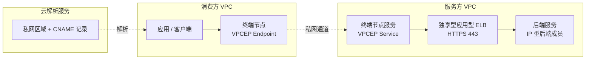
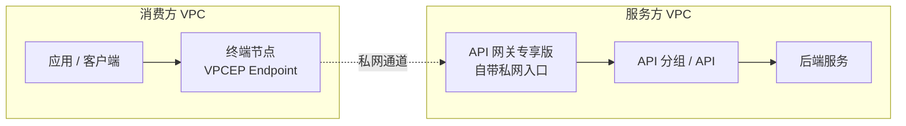

# 私网 SaaS 接入参考架构 / Private SaaS Access Reference Architectures

<!-- 章节 1: 标题与徽章 -->
[](LICENSE)
[](https://support.huaweicloud.com/intl/zh-cn/)
[](#)

> 基于 VPC 终端节点的多租户私网 SaaS 接入参考架构
> Multi-tenant private SaaS access reference architectures built on VPC endpoint services

---

## 1. 简介 / Overview

**中文**：本实践提供两种把 SaaS 服务**以内网方式**开放给其他 VPC 消费方的参考架构。服务方无需暴露公网入口，消费方在自己的 VPC 内创建终端节点即可通过私网地址访问服务，全程流量不经过公网。面向**平台运维 / 网络架构 / 后端研发**人员，可作为**生产模板**使用。

**English**: This repository delivers two reference architectures for exposing a SaaS service to consumers in other VPCs over private connectivity. No public ingress is required on the provider side; consumers create a VPC endpoint in their own VPC and reach the service through private addresses, with no traffic traversing the public internet. It targets **platform ops / network architects / backend engineers** and serves as a **production-ready template**.

### 核心能力

- **跨 VPC 私网接入**：消费方通过终端节点直连服务，服务端不绑定公网 IP
- **两种入口形态**：负载均衡直连、API 网关专享版接入，按业务形态二选一
- **TLS 终结与私网域名**：HTTPS 在服务端终结 TLS，消费方可用固定私网域名访问
- **连接准入控制**：支持连接审批、账号白名单、终端节点访问控制与监听器网段白名单
- **全量 IaC 交付**：Terraform 一键创建，服务方与消费方配置互相独立

---

## 2. 目录

- [1. 简介](#1-简介--overview)
- [2. 目录](#2-目录)
- [3. 架构图](#3-架构图)
- [4. 方案亮点](#4-方案亮点)
- [5. 涉及云服务](#5-涉及云服务)
- [6. 前置条件](#6-前置条件)
- [7. 快速开始](#7-快速开始)
- [8. 分步部署](#8-分步部署)
- [9. 使用方法 / 验证](#9-使用方法--验证)
- [10. 清理资源](#10-清理资源)
- [11. 详细说明](#11-详细说明)
- [12. 依赖](#12-依赖)
- [13. FAQ / 故障排除](#13-faq--故障排除)
- [14. 贡献指南](#14-贡献指南)
- [15. 许可证](#15-许可证)
- [16. 联系方式 / 维护者](#16-联系方式--维护者)

---

## 3. 架构图

> 服务方以内网入口暴露服务，消费方在自己的 VPC 内创建终端节点，两端通过终端节点服务建立私网通道。

### 模式一：负载均衡直连



**关键组件说明**：

- **终端节点（VPCEP Endpoint）**：部署在消费方 VPC 与子网，是消费方流量的私网入口
- **终端节点服务（VPCEP Service）**：部署在服务方 VPC，后端资源绑定负载均衡私网 IP 对应的端口
- **独享型应用型 ELB**：在服务端终结 TLS，按后端服务器组策略转发到后端服务
- **私网域名区域**：为终端节点注册易记域名，消费方应用无需硬编码 IP

### 模式二：API 网关专享版接入



**关键组件说明**：

- **API 网关专享版实例**：创建后自带私网入口与终端节点服务，无需额外搭建负载均衡
- **API 分组与 API**：按分组组织对外开放的接口，支持路径匹配与后端路由
- **终端节点白名单**：按账号维度控制哪些消费方可以通过私网入口接入

---

## 4. 方案亮点

- **零公网暴露**：服务端不绑定弹性公网 IP，攻击面收敛到 VPC 内部
- **架构极简**：终端节点服务可直接挂载负载均衡，无需额外搭建四层转发层
- **消费方可自服务**：服务方只需给出终端节点服务名称，消费方自行建立连接
- **域名解耦**：通过私网域名区域注册别名，后端 IP 变更对消费方透明
- **多层准入**：连接审批、账号白名单、终端节点访问控制、监听器网段白名单逐级收敛
- **两端独立交付**：服务方与消费方配置分离，互不感知对方 VPC 内部细节

---

## 5. 涉及云服务

| 服务 | 用途 | 备注 |
|---|---|---|
| 虚拟私有云 VPC | 承载服务方与消费方网络、子网与安全组 | 两端可同账号或跨账号 |
| 弹性负载均衡 ELB | 模式一的私网入口，终结 TLS 并转发后端流量 | 独享型应用型（L7 规格） |
| VPC 终端节点 VPCEP | 建立跨 VPC 私网通道 | 服务端为终端节点服务，消费端为终端节点 |
| API 网关 APIG | 模式二的 API 入口，自带私网终端节点服务 | 专享版实例 |
| 云解析服务 DNS | 私网域名解析区域与别名记录 | 区域需关联消费方 VPC |
| 统一身份认证 IAM | 账号、权限与跨账号白名单 | 终端节点服务权限按 domain ID 授权 |

> **提示**：所有服务均可通过本仓库的 Terraform 一键创建；如需清理，请参见 [第 10 节「清理资源」](#10-清理资源)。

---

## 6. 前置条件

| 项 | 要求 | 说明 |
|---|---|---|
| **账号** | 已开通华为云账号并完成实名认证 | 个人 / 企业账号均可 |
| **权限** | 账号具备 IAM **Tenant Administrator** 或等效权限 | 用于创建 VPC / ELB / VPCEP / APIG 等资源 |
| **Region** | 推荐 `cn-north-4` | 各区域服务可用性与规格存在差异 |
| **Terraform** | `>= 1.5.0` | IaC 部署工具 |
| **huaweicloud Provider** | `~> 1.70` | 华为云 Terraform Provider（实测 1.96.0 校验通过） |
| **AK/SK** | 在华为云『我的凭证』页面获取 Access Key ID 与 Secret Access Key | 不要将凭据写入任何代码或配置文件 |
| **后端服务** | 已在服务方 VPC 内部署可访问的业务服务 | 需提供私网地址与端口 |

**访问密钥准备**（在华为云『我的凭证』页面获取 AK/SK，任选其一，均不落盘）：

**方式一：子模块独立部署（推荐）**——华为云 provider 自动读取环境变量，无需在代码中声明 provider 块。

```bash
export HW_ACCESS_KEY="<AK>"
export HW_SECRET_KEY="<SK>"
export HW_REGION_NAME="cn-north-4"
```

**方式二：根模块统一编排**（`infra/` 目录，见第 7 节「根模块一键编排」）——使用 Terraform 变量。

```bash
export TF_VAR_access_key="<AK>"
export TF_VAR_secret_key="<SK>"
export TF_VAR_region_name="cn-north-4"
```

仓库内任何 `.tf` / 文档均使用占位符，**不出现真实凭据**。

---

## 7. 快速开始

### 模式一：负载均衡直连

```bash
# 1. 进入本仓库根目录
cd <本仓库根目录>

# 2. 准备访问密钥（见第 6 节）：export HW_ACCESS_KEY / HW_SECRET_KEY / HW_REGION_NAME
#    若改用 infra/ 根模块一键编排，则改为 export TF_VAR_access_key / TF_VAR_secret_key / TF_VAR_region_name

# 3. 服务端：创建负载均衡与终端节点服务
cd infra/elb_vpcep_service
cp terraform.tfvars.example terraform.tfvars
# 按实际环境编辑 terraform.tfvars
terraform init
terraform plan
terraform apply -auto-approve
```

### 模式二：API 网关专享版接入

```bash
cd <本仓库根目录>/infra/apig_vpcep_service
cp terraform.tfvars.example terraform.tfvars
# 按实际环境编辑 terraform.tfvars
terraform init
terraform plan
terraform apply -auto-approve
```

### 消费方：建立终端节点

```bash
cd <本仓库根目录>/infra/consumer_vpcep_endpoint
cp terraform.tfvars.example terraform.tfvars
# 填入服务端输出的 endpoint_service_name 与消费方 VPC / 子网信息
terraform init
terraform plan
terraform apply -auto-approve
```

### 根模块一键编排

若希望用一次 `terraform apply` 把三种模式编排到一起（或按需只部署其中几种），可直接在 `infra/` 根目录操作：

```bash
cd <本仓库根目录>/infra
# 凭据用 Terraform 变量提供（子模块独立部署则用 HW_ACCESS_KEY / HW_SECRET_KEY / HW_REGION_NAME）
export TF_VAR_access_key="<AK>"
export TF_VAR_secret_key="<SK>"
export TF_VAR_region_name="cn-north-4"

cp terraform.tfvars.example terraform.tfvars
# 编辑 terraform.tfvars：按需设置 deploy_elb / deploy_apig / deploy_consumer 开关，
# 并填入各模式对应的 VPC / 子网 / 后端等参数
terraform init
terraform plan
terraform apply -auto-approve
```

- `deploy_elb=true`（默认）：部署模式一（负载均衡直连）
- `deploy_apig=false`（默认）：设为 `true` 可同时部署模式二（API 网关专享版）
- `deploy_consumer=false`（默认）：完成服务端部署、拿到 `endpoint_service_id` / `endpoint_service_name` 后再设为 `true`

> 子模块仍可直接进入各自目录独立部署，两种路径共享同一套资源定义。

> **部署耗时**：模式一约 5-10 分钟，模式二约 20-30 分钟（API 网关专享版实例创建耗时较长）。
> **完整步骤与每步预期输出**：参见 [第 8 节「分步部署」](#8-分步部署)。

---

## 8. 分步部署

### 步骤 1：初始化工作目录

```bash
cd <本仓库根目录>/infra/elb_vpcep_service
terraform init
```

**预期输出**：`Terraform has been successfully initialized!`

### 步骤 2：预演资源变更

```bash
terraform plan
```

**预期输出**：`Plan: N to add, 0 to change, 0 to destroy.`

### 步骤 3：执行部署

```bash
terraform apply -auto-approve
```

**预期输出**：`Apply complete! Resources: N added, 0 changed, 0 destroyed.`

### 步骤 4：记录关键输出

```bash
terraform output
```

**预期输出**：

```
endpoint_service_name = "cn-north-4.privsaas-svc.xxxxxxxx-xxxx-xxxx-xxxx-xxxxxxxxxxxx"
endpoint_service_id   = "xxxxxxxx-xxxx-xxxx-xxxx-xxxxxxxxxxxx"
private_zone_id       = "xxxxxxxxxxxxxxxxxxxxxxxxxxxxxxxx"
service_address       = "10.0.1.100"
```

### 步骤 5：消费方建立连接

将上一步的 `endpoint_service_name`（或 `endpoint_service_id`）填入 `infra/consumer_vpcep_endpoint/terraform.tfvars`，执行消费方部署流程。若服务端开启了连接审批，需在控制台「终端节点服务 → 连接管理」中接受连接。

---

## 9. 使用方法 / 验证

> **本节命令需在资源创建完成后执行**。当前交付范围包含代码与静态校验（`terraform fmt` / `terraform validate` 均通过），下列运行时验证需在完成部署后由使用者执行；请按本节步骤自行验证，确认业务功能可用后方可视为交付完成。

### 验证 1：静态检查（可立即执行）

```bash
cd <本仓库根目录>/infra/elb_vpcep_service
terraform fmt -check
terraform validate
```

**预期输出**：

```
Success! The configuration is valid.
```

> 模式二与消费方目录执行相同命令，同样应输出 `Success! The configuration is valid.`

### 验证 2：终端节点服务已就绪

```bash
cd <本仓库根目录>/infra/elb_vpcep_service
terraform output endpoint_service_name
terraform output endpoint_service_id
```

**预期输出**：返回终端节点服务名称与 ID，服务名称格式为 `<region>.<service-name>.<service-id>`。

### 验证 3：消费方终端节点连接状态

```bash
cd <本仓库根目录>/infra/consumer_vpcep_endpoint
terraform output endpoint_status
terraform output service_access_address
```

**预期输出**：`endpoint_status` 为 `accepted`，`service_access_address` 返回可访问的域名或私网地址。

### 验证 4：业务端到端

```bash
# 在消费方 VPC 内的云服务器上访问私网服务
curl -vk https://<service_access_address>:443/health
```

**预期结果**：返回后端服务的健康检查结果（HTTP 200），TLS 握手成功且证书与服务端配置一致。

---

## 10. 清理资源

```bash
# 先释放消费方资源
cd <本仓库根目录>/infra/consumer_vpcep_endpoint
terraform destroy -auto-approve

# 再释放服务端资源
cd <本仓库根目录>/infra/elb_vpcep_service
terraform destroy -auto-approve
```

**预期输出**：`Destroy complete! Resources: N destroyed.`

> **避免资源残留**：
> - `terraform destroy` 仅释放 Terraform state 中追踪的资源；
> - ELB 需先删除后端服务器组与监听器，若销毁中断请按此顺序重试；
> - 账号内其他任务共享的 VPC / 子网等公共资源不会被影响。

---

## 11. 详细说明

### 工作流程

1. 服务方在自身 VPC 内创建私网入口（负载均衡或 API 网关专享版实例），后端指向已有业务服务
2. 服务方创建终端节点服务，后端资源绑定该私网入口，并声明端口映射
3. 服务方按需开启连接审批、配置账号白名单
4. 消费方在自身 VPC 内创建终端节点，按名称关联服务方的终端节点服务
5. 服务方接受连接后，通道建立；消费方通过终端节点私网地址或私网域名访问服务
6. 流量路径：消费方应用 → 终端节点 → 私网通道 → 终端节点服务 → 私网入口 → 后端服务

### 配置项

| 变量 | 默认值 | 说明 |
|---|---|---|
| `region_name` | `cn-north-4` | 部署区域，两端需一致 |
| `name_prefix` | `privsaas` | 资源名称前缀 |
| `vpc_id` | 必填 | 服务端 VPC ID |
| `ipv4_subnet_id` | 必填 | 负载均衡所在子网（子网资源的 `ipv4_subnet_id` 字段） |
| `availability_zones` | `["cn-north-4a", "cn-north-4b"]` | 可用区列表，需与后端服务一致 |
| `l7_flavor_name` | `L7_flavor.elb.s1.small` | 独享型七层规格名称，用于精确查规格 UUID |
| `listener_protocol` | `HTTPS` | `HTTPS` 在负载均衡终结 TLS，`TCP` 为四层透传 |
| `listener_port` | `443` | 对外服务端口 |
| `backend_addresses` | `[]` | 后端服务私网地址列表 |
| `access_cidrs` | `[]` | 消费方网段白名单，留空表示不限制 |
| `endpoint_service_approval` | `false` | 是否需要对端连接审批 |
| `endpoint_service_permissions` | `[]` | 允许接入的账号列表，格式 `iam:domain::<domain_id>` |
| `private_zone_name` | `saas.internal` | 私网域名后缀 |

### 接口 / API

模式二通过 API 网关对外暴露接口，默认配置如下：

| 项 | 值 |
|---|---|
| 请求方法 | `ANY` |
| 请求路径 | `/v1/saas` |
| 匹配方式 | 前缀匹配 |
| 认证方式 | 无认证（可按业务需要调整为 APP / IAM） |
| 后端地址 | `api_backend_address` 变量指定 |

---

## 12. 依赖

### 主要依赖

| 名称 | 版本 | 用途 |
|---|---|---|
| Terraform | `>= 1.5.0` | IaC 编排 |
| huaweicloud Provider | `~> 1.70` | 华为云资源编排（实测 1.96.0 校验通过） |

---

## 13. FAQ / 故障排除

### Q1：部署时提示「权限不足」怎么办？

**A**：确认账号具备 IAM **Tenant Administrator** 权限，或至少包含 `VPC Administrator`、`ELB Administrator`、`APIG Administrator` 等子服务管理员权限。

### Q2：创建终端节点服务时报「规格不存在」或 UUID 类型错误？

**A**：`l7_flavor_id` 必须是规格 UUID 而非规格名称。本仓库已通过 `huaweicloud_elb_flavors` 数据源按 `l7_flavor_name` 精确解析 UUID；若区域不支持默认规格名称，请改填该区域实际存在的规格名。

### Q3：消费方终端节点状态一直是 `pendingAcceptance`？

**A**：服务端开启了连接审批（`endpoint_service_approval = true`）。请在服务方控制台「终端节点服务 → 连接管理」中接受该连接，或将变量改为 `false` 后重新应用。

### Q4：消费方可以连通终端节点 IP，但私网域名解析失败？

**A**：确认已满足两点：① 消费方模块中 `private_zone_id` 已填入服务端输出的私网区域 ID（模块会自动把区域关联到消费方 VPC）；② 消费方云服务器使用的 DNS 能解析该私网区域。

### Q5：销毁时监听器删不掉？

**A**：华为云要求先删后端服务器组、再删监听器、最后删负载均衡。若 `destroy` 中断，重新执行 `terraform destroy` 即可按依赖图继续。

### 故障排查清单

| 现象 | 可能原因 | 排查方法 |
|---|---|---|
| 终端节点服务看不到负载均衡 | 后端资源类型或端口 ID 不匹配 | 确认 `server_type = "LB"` 且 `port_id` 取负载均衡私网 IP 对应的端口 ID |
| 消费方访问超时 | 安全组 / 监听器白名单未放通消费方网段 | 检查 `access_cidrs` 与后端服务安全组入方向规则 |
| TLS 握手失败 | 监听器未绑定证书或证书域名不匹配 | 检查 `certificate_id`，或由模块依据证书内容创建后重新应用 |
| 私网域名解析到旧地址 | CNAME 记录 TTL 未过期 | 等待 TTL 到期，或调小 `record_ttl` 后重新应用 |

---

## 14. 贡献指南

欢迎提交 Issue 与 PR。请遵循以下流程：

1. **Issue**：描述问题 / 建议（含复现命令、预期 / 实际输出、截图）
2. **PR**：基于 `main` 分支新建 feature 分支；提交前运行 `terraform validate`
3. **Code Review**：由 reviewer 审核通过后合并

---

## 15. 许可证

本实践采用 **MIT No Attribution** 许可证发布。详见仓库根目录 [`LICENSE`](LICENSE) 文件。

```
MIT No Attribution

Copyright (c) Huawei Cloud

Permission is hereby granted, free of charge, to any person obtaining a copy
of this software and associated documentation files (the "Software"), to deal
in the Software without restriction, including without limitation the rights
to use, copy, modify, merge, publish, distribute, sublicense, and/or sell
copies of the Software, and to permit persons to whom the Software is
furnished to do so.
```

---

## 16. 联系方式 / 维护者

| 项 | 内容 |
|---|---|
| **创建者** | 邓桂材 |
| **维护者** | 邓桂材 |
| **联系方式** | 通过仓库 Issue 反馈 |
| **反馈渠道** | 提交 Issue / PR（见 [第 14 节](#14-贡献指南)） |
