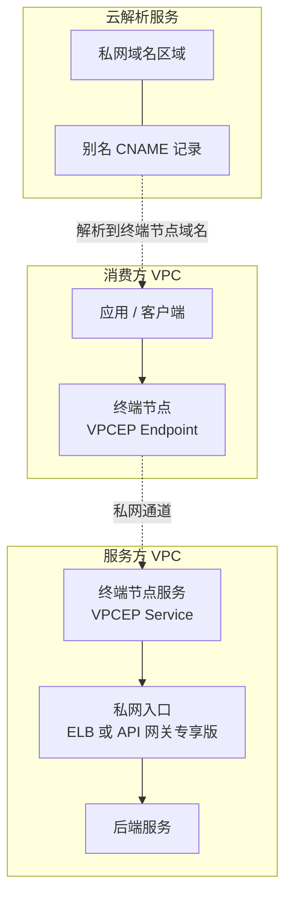

# 私网 SaaS 接入架构说明

## 1. 设计目标

SaaS 提供方需要把服务开放给位于其他 VPC 的消费方，同时满足：

- 服务端不暴露公网入口，攻击面收敛在 VPC 内部
- 消费方以私网地址访问，流量不经过公网
- 服务方能够控制谁可以接入（账号、网段、连接审批）
- 后端服务扩容或换 IP 时，消费方无需改动

## 2. 总体拓扑

## 3. 两种入口形态对比

| 维度 | 模式一：负载均衡直连 | 模式二：API 网关专享版 |
|---|---|---|
| 私网入口 | 独享型应用型 ELB | API 网关专享版实例（自带私网入口） |
| 适用业务 | 已有 HTTP 服务，只需打通网络 | 需要 API 生命周期管理、鉴权、流控 |
| TLS 终结位置 | ELB 监听器（`HTTPS` 协议） | API 网关实例 |
| 后端形态 | IP 型后端服务器组成员 | API 后端地址或 VPC 通道 |
| 组件数量 | VPC / 子网 / 安全组 / ELB / 监听器 / 后端组 / 终端节点服务 | VPC / 子网 / 安全组 / APIG 实例 / 分组 / API |
| 接入控制 | 监听器 IP 地址组 + 终端节点服务权限 | 终端节点白名单 + API 认证方式 |

## 4. 模式一：负载均衡直连

### 组件职责

| 组件 | 职责 |
|---|---|
| 独享型应用型 ELB | 私网入口，在监听器上终结 TLS，按后端服务器组策略转发 |
| 后端服务器组 | 维护 IP 型后端成员与负载均衡算法 |
| 健康检查 | 按协议周期性探测后端成员，剔除异常节点 |
| 监听器 IP 地址组 | 限制可以访问监听端口的消费方网段 |
| 终端节点服务 | 以负载均衡私网 IP 对应的端口作为后端资源，声明端口映射 |
| 私网域名区域 | 为终端节点注册易记域名 |

### 数据流

1. 消费方应用发起 `https://<别名域名>:443` 请求
2. 私网域名解析到终端节点内网域名，再解析到终端节点私网地址
3. 请求经私网通道送达终端节点服务
4. 终端节点服务转发到后端负载均衡的私网端口
5. 负载均衡终结 TLS，按后端服务器组策略转发到后端成员
6. 响应按原路返回

### 设计取舍

- **单一入口**：终端节点服务可直接挂载负载均衡，因此不再额外搭建四层转发层，链路更短
- **私网 TLS**：TLS 在 ELB 监听器终结，后端可用明文 HTTP，简化后端证书管理；如需端到端加密，把 `listener_protocol` 改为 `TCP`、`backend_protocol` 改为 `HTTPS`
- **准入分层**：监听器 IP 地址组管网段，终端节点服务权限管账号，两层可叠加

## 5. 模式二：API 网关专享版接入

### 组件职责

| 组件 | 职责 |
|---|---|
| API 网关专享版实例 | 提供私网入口与自带的终端节点服务，承载 API 运行时 |
| API 分组 | 按业务域组织 API，便于分组授权与发布 |
| 环境 | 隔离开发 / 测试 / 正式环境，API 按环境发布 |
| API | 定义请求方法、路径、匹配方式与后端路由 |
| 终端节点白名单 | 按账号维度限制可通过私网入口接入的消费方 |

### 数据流

1. 消费方应用发起请求到终端节点私网地址
2. 请求经私网通道送达 API 网关实例的私网入口
3. 网关按请求路径匹配到对应 API 分组与 API
4. API 按后端配置转发到后端服务地址
5. 响应按原路返回

### 设计取舍

- **免建负载均衡**：专享版实例自带私网入口与终端节点服务，模式二不再额外创建 ELB、监听器与证书
- **端口约定**：模式二默认使用 443 端口，安全组需放通消费方网段
- **连接审批**：连接管理按终端节点粒度操作，需在控制台处理，代码中未固化为资源

## 6. 消费方接入模型

消费方配置独立成一个模块，两种模式共用：

| 步骤 | 动作 |
|---|---|
| 1 | 取得服务端输出的终端节点服务名称或 ID |
| 2 | 在消费方 VPC 与子网创建终端节点 |
| 3 | 可选：开启访问控制白名单，限制可访问终端节点的 IP |
| 4 | 可选：把服务端私网域名区域关联到消费方 VPC |
| 5 | 可选：注册别名 CNAME 记录，指向终端节点内网域名 |

## 7. 安全设计

| 层面 | 措施 |
|---|---|
| 网络 | 服务端不绑定公网 IP，仅经终端节点服务暴露 |
| 网段 | 监听器 IP 地址组与终端节点访问控制白名单按 CIDR 收敛 |
| 账号 | 终端节点服务权限按 `iam:domain::<domain_id>` 授权，或实例终端节点白名单 |
| 连接 | 支持连接审批，未审批的连接不生效 |
| 传输 | TLS 在服务端终结，支持按证书 ID 或直接提供证书内容 |
| 凭据 | AK/SK 在华为云『我的凭证』页面获取，经环境变量提供给 Terraform，代码中不出现明文 |

## 8. 高可用与扩展

- **多可用区**：ELB 与 API 网关实例均支持多可用区部署，`availability_zones` 需与后端服务保持一致
- **后端扩容**：后端成员以 IP 列表维护，扩容只需追加 `backend_addresses` 后重新应用
- **消费方扩展**：新增消费方只需在其 VPC 复用消费方模块，服务端无变更
- **域名解耦**：后端 IP 变更后，只需更新 CNAME 记录指向，消费方应用无需改动
